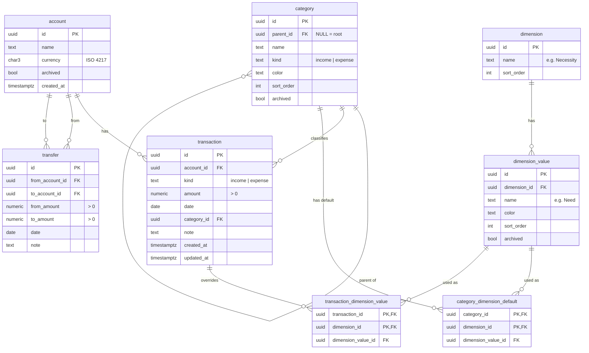

# Data Model

> **Status:** DRAFT proposal for the Phase 1 workshop. Rationale for categories: [ADR 0002](adr/0002-category-model.md).

## ER diagram

## Rules

### Money

- The DB stores `NUMERIC(19,4)`, Python uses `Decimal`, and JSON carries amounts as **strings** (e.g. `"1250.50"`). Floats are never used.
- A transaction's currency is the currency of its account; it is not stored on the transaction.
- `amount` is always positive. The direction comes from `kind` (and from `from`/`to` for transfers).

### Category tree

- Adjacency list: `parent_id` points to the parent, and `NULL` marks a root.
- A child must have the same `kind` as its parent.
- No cycles: a category cannot be moved under itself or its descendant. This is checked in the API.
- A transaction points to **one** node, which may be a non-leaf (open question). Ancestors are implied, so
  rolled-up totals never count a transaction twice.
- Roll-up totals use a recursive CTE (`WITH RECURSIVE`) in PostgreSQL.

### Dimensions

- A dimension is an independent way of classifying transactions (e.g. _Necessity_), separate from the category tree.
- A transaction has **at most one value per dimension** (enforced by the PK `(transaction_id, dimension_id)`).
  `dimension_id` is stored redundantly in the link tables so that this constraint can be expressed. A composite FK
  `(dimension_value_id, dimension_id)` keeps it consistent.
- **Effective value** of a dimension for a transaction:
  1. the override in `transaction_dimension_value`, if there is one, otherwise
  2. the default on the transaction's category, otherwise
  3. the default on the nearest ancestor category, otherwise
  4. _unassigned_.
- Example: _Food_ has the default **Need**, while _Food → Restaurants_ has its own default **Want**. A restaurant
  transaction on a work trip can be overridden to **Need**.

### Transfers

- `from_account_id ≠ to_account_id`.
- Same currency: `from_amount = to_amount` (the UI shows one amount field).
- Different currencies (exchange): both amounts are entered, and the rate is `to_amount / from_amount`.
- Account balance = Σ income − Σ expense − Σ outgoing `from_amount` + Σ incoming `to_amount`.

### Archiving

- Accounts, categories and dimension values have `archived` and are never hard-deleted once something refers to them.
- Transactions and transfers can be hard-deleted.

## Later (not in the MVP)

| Entity                                                          | Purpose                                             |
| --------------------------------------------------------------- | --------------------------------------------------- |
| `tag`, `transaction_tag`                                        | Free many-to-many labels (e.g. _Vacation 2026_)     |
| `exchange_rate`                                                 | Rates for reporting in a base currency              |
| `import_batch`, `transaction.status`, `transaction.external_id` | Bank CSV import with review and duplicate detection |
| `categorisation_rule`                                           | Auto-assign category from description/counterparty  |
| `transaction_split`                                             | One payment split across several categories         |
| `recurring_rule`, `goal`, `budget`                              | Recurring payments, savings goals, budgets          |
