# Data Model

> **Status:** DRAFT proposal for the Phase 1 workshop. Rationale for categories: [ADR 0002](adr/0002-category-model.md).
> Rationale for no accounts and CZK only: [ADR 0003](adr/0003-no-accounts-czk-only.md).

## ER diagram

```mermaid
erDiagram
    category ||--o{ category : "parent of"
    category ||--o{ transaction : "classifies"
    category ||--o{ recurring_template : "classifies"
    category ||--o{ category_dimension_default : "has default"
    dimension ||--o{ dimension_value : "has"
    dimension_value ||--o{ category_dimension_default : "used as"
    dimension_value ||--o{ transaction_dimension_value : "used as"
    transaction ||--o{ transaction_dimension_value : "overrides"

    category {
        uuid id PK
        uuid parent_id FK "NULL = one of the 2 roots"
        text name
        text kind "income | expense, same as its root"
        text color
        int sort_order
        bool archived
    }
    dimension {
        uuid id PK
        text name "e.g. Necessity"
        int sort_order
    }
    dimension_value {
        uuid id PK
        uuid dimension_id FK
        text name "e.g. Need"
        text color
        int sort_order
        bool archived
    }
    category_dimension_default {
        uuid category_id PK, FK
        uuid dimension_id PK, FK
        uuid dimension_value_id FK
    }
    transaction {
        uuid id PK
        numeric amount "income > 0, expense can be negative"
        date month "first day of the month"
        smallint day "NULL = unknown, 1-31"
        uuid category_id FK "decides income or expense"
        text note
        timestamptz created_at
        timestamptz updated_at
    }
    transaction_dimension_value {
        uuid transaction_id PK, FK
        uuid dimension_id PK, FK
        uuid dimension_value_id FK
    }
    recurring_template {
        uuid id PK
        text name "e.g. Rent"
        uuid category_id FK
        numeric amount "prefilled value"
        text note
        int sort_order
        bool archived
    }
```

## Rules

### Money

- The DB stores `NUMERIC(19,4)`, Python uses `Decimal`, and JSON carries amounts as **strings** (e.g. `"1250.50"`). Floats are never used.
- All amounts are in CZK. There is no currency column yet. Currencies are added later with a migration that adds
  `currency` with the default `CZK`, so the existing data stays valid.
- Whether a transaction is an income or an expense comes from its category (the income tree or the expense tree), not from a separate field.
- Income `amount` is always > 0. An expense `amount` may be negative (a refund or complaint) but never 0. This is checked in the API and by a DB check.
- The balance of a period is Σ income − Σ expense. It is not a bank balance.

### Time

- A transaction always has a `month` (the first day of the month, enforced by a check). Reports group by it.
- `day` is optional (1–31, and it must exist in that month, checked in the API). Without a day, a transaction sorts after those with a day, in order of entry.
- A year is the set of its 12 months.

### Category tree

- There are **two separate trees**: one under the root **Income** and one under the root **Expenses**. The two roots are
  created by the first migration, and they cannot be renamed, moved, archived or deleted.
- Adjacency list: `parent_id` points to the parent, and `NULL` marks a root. Only the two roots have `NULL`.
- Every category has the same `kind` as its root. A category can never be moved to the other tree. This is checked in the API.
- No cycles: a category cannot be moved under itself or its descendant. This is checked in the API.
- **Inserting an intermediate category** is one operation in the API: create the new parent under the given parent and
  move the chosen sibling categories under it in one database transaction. Transactions keep their categories.
- A transaction points to **one** node, which may be a non-leaf (open question). Ancestors are implied, so
  rolled-up totals never count a transaction twice.
- Roll-up totals use a recursive CTE (`WITH RECURSIVE`) in PostgreSQL. The detail level of an overview is a depth limit on that query.

### Dimensions

- A dimension is an independent way of classifying transactions (e.g. _Necessity: Need / Want / Saving_), separate from the category tree.
- The MVP seeds one dimension, _Necessity_ (Need, Want, Saving). The tables allow more.
- _Necessity_ applies to **expense** categories and transactions only. Income does not have it.
- A transaction has **at most one override per dimension** (enforced by the PK `(transaction_id, dimension_id)`).
  `dimension_id` is stored redundantly in the link tables so that this constraint can be expressed. A composite FK
  `(dimension_value_id, dimension_id)` keeps it consistent.
- **Effective value** of a dimension for a transaction:
  1. the override in `transaction_dimension_value`, if there is one, otherwise
  2. the default on the transaction's category, otherwise
  3. the default on the nearest ancestor category.

  There is **no unassigned value**. The **Expenses** root always has a default (set by the first migration, and it can be
  changed but not removed), so step 3 always finds one. The API refuses to delete a default from any category that is a root,
  and a transaction without a resolvable value cannot exist.

- Example: _Food_ has the default **Need**, while _Food → Restaurants_ has its own default **Want**. A restaurant
  transaction on a work trip can be overridden to **Need**.

### Regular payments

- `recurring_template` is a prefilled row, not a schedule. Nothing is created automatically.
- **Copy into a month:** the API returns the active templates as proposed transactions for that month. The user edits them,
  and one request saves them as ordinary transactions. They take their Necessity value from the category default and can be
  overridden afterwards. The transactions do not keep a link to the template, and the app does not check for duplicates.
- A template has a **name** (e.g. _Rent_) so that it can be recognised in the list. It also has a category, an amount and a note.

### Archiving

- Categories and dimension values have `archived` and are never hard-deleted once something refers to them.
- Transactions can be hard-deleted. Templates can be archived.

## Later (not in the MVP)

| Entity                                                          | Purpose                                                            |
| --------------------------------------------------------------- | ------------------------------------------------------------------ |
| `currency`, `exchange_rate`, `transaction.currency`             | Currencies, rates valid from a date, reporting in CZK              |
| `account`, `transfer`, `balance_check`                          | Accounts, balances, and a correction when the real balance differs |
| `import_batch`, `transaction.status`, `transaction.external_id` | Bank list import with review and duplicate detection               |
| `purchase_detail`                                               | Purchase date, end of warranty, receipt                            |
| `tag`, `transaction_tag`                                        | Free many-to-many labels (e.g. _Vacation 2026_)                    |
| `transaction_split`, spread over months                         | One payment split across categories or months                      |
| `categorisation_rule`, `goal`, `budget`                         | Auto-categorisation, target ratio, budgets                         |
